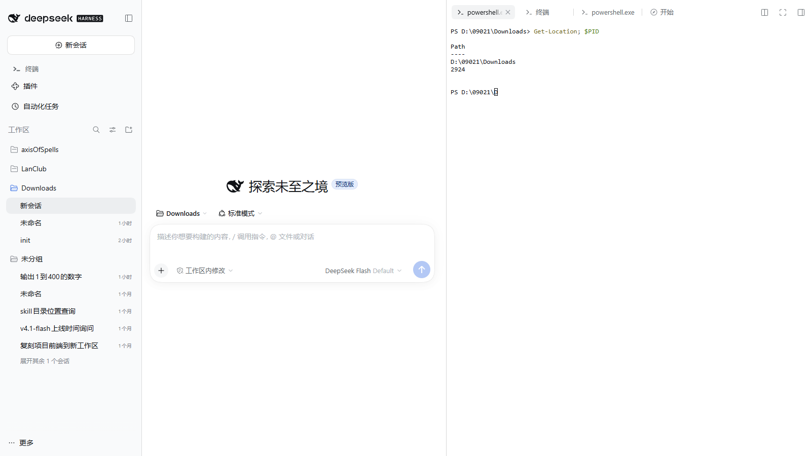
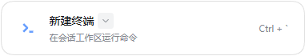

# dsh-fast-term

DSH（DeepSeek Harness）右侧边栏里的**终端**：专用 PTY WebSocket，直连、无帧确认，目标是把「按键 → 回显」的峰值延迟压到最低。

它刻意做成自带终端的替代品：入口叫「新建终端」、占用同一个右栏标签槽位、接管 `Ctrl + \``，并配合一行 profile 补丁隐藏自带终端的按钮与 UI。





```
右侧边栏 → 新建终端（或 Ctrl + `）
```

## 为什么

DSH 自带终端的输出要先经过网关 mux（所有 Typert Remote 流共用一条物理 WebSocket），每一帧还要等浏览器 ack；宿主同时把同样的输出再喂给一份 headless xterm，用于重连快照。空闲时这套开销只有十几毫秒，但一旦主线程被聊天流 / Markdown 渲染占住，帧就会排队，按键回显能拖到秒级。

dsh-fast-term 把 PTY 输出直接推到一条专用 WebSocket，不排队、不等 ack、宿主也不做 headless 镜像；xterm 在会话标签里直接渲染。

同一台 Windows 机器、隔离的 web profile、Playwright 驱动、按 WebSocket 帧时间戳计时：

| 场景 | DSH 自带终端 | dsh-fast-term |
| --- | --- | --- |
| 冷启动到出提示符 | 3.1–3.2 s | ~0.12 s（复用已存在的 PTY） |
| 空闲按键回显 | 11.7–12.9 ms | 9.9–14.7 ms |
| 主线程 75% 合成负载下 | 43–46 ms | 4.8–35.7 ms |
| 2.99 MB 输出洪水中 | 12.8 s | 2.9 s |

> 数字来自隔离 profile 的对照实验；真实使用时如果聊天记录很大，渲染线程仍然会拖慢任何 web 终端——这是浏览器单线程的代价，不是传输层的。

## 功能

- 会话级右侧栏标签，位置与自带终端一致（`sidebar.right.pane.tab` 槽位）
- `Ctrl + \`` 新建终端（快捷键 id `fastterm.new`；隐藏自带终端后不会有冲突）
- 入口卡片与自带终端同款：图标、标题、描述、`Ctrl + \`` 提示，带 shell 下拉菜单（PowerShell / cmd / 可发现的其它 shell），选择会被记住
- 标签标题显示实际 shell（`powershell.exe`、`cmd.exe`…），双击可重命名，名字保存在宿主端（刷新页面、切换标签都不丢）
- 终端配色跟随 DSH 主题（浅色 / 深色 / 跟随系统），字体与字号读主题令牌，和自带终端一致
- 中英双语（跟随 DSH 语言设置）
- 每个标签一个独立 PTY；标签切换、页面刷新后自动重连并回放快照，PTY 不随标签卸载退出（`keepMounted`）
- 新标签的工作目录 = 会话工作目录（读 `workingDirectory` 投影）
- 关闭标签会结束对应 PTY（`sidebarRight.registerCloseHandler` + `POST /api/dsh-fast-term/close`）
- Windows 默认 PowerShell：pwsh → Windows PowerShell → ComSpec 依次回退，可用 `DSH_FAST_TERM_SHELL` 覆盖
- 过滤 xterm 的 Device Attributes 应答，避免 PowerShell 把 `[?1;2c` 当输入回显
- 外部输入开关：默认只读，只有终端界面本身可以输入；点终端右上角的「只读」胶囊才会允许其它进程（含 Agent）通过 WebSocket 写入，可另配命令白名单
- 复制粘贴：选中后 `Ctrl+C` 或 `Ctrl+Shift+C` 复制（没有选中时 `Ctrl+C` 仍是 SIGINT），`Ctrl+V` 粘贴；`Ctrl+Shift+V` 走浏览器原生粘贴；右键菜单提供复制 / 粘贴 / 全选，复制成功会在底部提示字数
- 桌面版快捷键让行：终端获得焦点时，所有「单个 Ctrl」组合的 DSH 快捷键会临时让给终端（tmux 的 `Ctrl+B` 前缀不再触发侧边栏开关），失焦后立即恢复；不写入用户快捷键配置

## 安装

```
dsh plugin --profile desktop add dsh-fast-term
```

也可以在「设置 → 插件市场」里搜索 `dsh-fast-term`。本地开发时直接装目录：

```
dsh plugin --profile desktop add "file:D:/Projects/dsh-fast-term"
```

安装或更新后需要重启 DSH 宿主（右侧栏的客户端半在刷新页面后生效）。注意 `file:` 依赖在 pnpm 里是拷贝而不是软链，改了 `lib/` 之后要重新 `add` 一次（或手动把 `lib/index.js`、`lib/client.js` 覆盖到 profile 的 `node_modules/dsh-fast-term/lib/`）。

## 替代自带终端

想让「新建终端」按钮和终端 UI 完全由本插件接管，在 profile 的补丁层里关掉自带终端 UI（`C:\Users\<你>\.dsh\profiles\desktop\cordis.patch.yml`）：

```yaml
- id: ui-sidebar-terminal
  name: "@deepseek-ai/dsh-client-ui-sidebar-terminal"
  disabled: true
```

重启后：右栏「开始」页只剩「工作区文件」和「新建终端」，`Ctrl + \`` 打开的是本插件；关掉的是自带终端的**界面**，终端服务（`webTerminals` / `dsh-api-terminal-controller`）仍在，其它插件的终端不受影响。

不想替代、想并存也可以——删掉这三行即可，两个终端会各占一张卡片（自带终端仍显示为 `New terminal`）。

## 使用

1. 打开右侧边栏
2. 点「新建终端」，或直接按 `Ctrl + \``；点标题旁的箭头可以选择 shell
3. 直接输入命令即可；双击标签标题可以重命名；关闭标签 = 结束该 PTY
4. 终端右上角的胶囊显示当前输入权限：`只读` 表示只有这个界面能输入；点一下变成 `可输入`，其它程序或 Agent 才能通过 WebSocket 向该 PTY 写入；再点一下恢复只读
5. 鼠标选中文本后 `Ctrl+C`（或 `Ctrl+Shift+C`）复制、`Ctrl+V` 粘贴；也可以右键打开菜单（复制 / 粘贴 / 全选）。没有选中时 `Ctrl+C` 照常发送 SIGINT
6. 桌面版 Windows/macOS：鼠标点进终端获得焦点后，`Ctrl+B` 这类单 Ctrl 快捷键会直接发给终端（tmux 前缀可用）；点回页面其它位置即恢复 DSH 的快捷键

Windows 下进程的环境变量在启动那一刻就固定了，宿主连续跑很久时终端会一直用旧的 `PATH`（新装的 CLI 找不到）。本插件在创建 PTY 前会从注册表重读 `Path`（HKLM + HKCU，展开 `%VAR%`，5 秒缓存），所以改完 PATH 不用重启宿主，新开一个标签就能拿到；宿主运行时额外追加、且仍在磁盘上的目录也会保留。

## 只读接口与输入开关

宿主进程提供三个只读 HTTP 接口，供脚本或 Agent 查看终端状态（仅回环 + Origin 校验）：

| 接口 | 说明 |
| --- | --- |
| `GET /api/dsh-fast-term/list` | 列出终端：`id` / `title` / `shell` / `pid` / `exited` |
| `GET /api/dsh-fast-term/buffer?id=<id>&tail=8000&plain=1` | 返回该终端输出缓冲的尾部；省略 `id` 取最近一个；`plain=0` 返回带 ANSI 转义的原始 PTY 流 |
| `GET /api/dsh-fast-term/screen?id=<id>&cols=120&rows=40` | 用缓冲区重放一帧**可见画面**，返回按行拆好的文本（`text`）；省略 `cols`/`rows` 用该终端最近一次尺寸 |

输入开关保存在 `~/.dsh/fast-term.json`，也可通过接口读写：

| 接口 | 说明 |
| --- | --- |
| `GET /api/dsh-fast-term/config` | 读取 `{allowExternalInput, allowedCommands}` |
| `POST /api/dsh-fast-term/config` | 改开关，例如 `{"allowExternalInput":true,"allowedCommands":["echo","git status"]}` |

`allowExternalInput` 为 `false`（默认）时，只有终端界面自己的连接（attach 时声明 `writer: "ui"`）可以输入；其它 WebSocket 客户端发来的 `input` 会被拒绝并收到 `{"type":"denied","reason":"read-only"}`。打开后，`allowedCommands` 非空则按**整行**前缀匹配（大小写不敏感，回车才提交）：不在白名单里的行被丢弃并返回 `{"type":"denied","reason":"command-not-allowed","detail":"<行>"}`；留空表示不限制。

`plain=1`（默认）会去掉转义序列并统一换行为 `\n`，适合直接阅读；它不是终端模拟器，不会还原光标移动，所以 `PSReadLine` 之类的逐键重绘会留下重复片段。要看光标定位重画的全屏 TUI（btop、vim、tmux 状态栏），用 `screen`：宿主用 `@xterm/headless` 把缓冲重放成 120×40 的屏幕，再按行输出纯文本，得到的就是用户此刻看到的画面。

```bash
curl "http://127.0.0.1:PORT/api/dsh-fast-term/list"
curl "http://127.0.0.1:PORT/api/dsh-fast-term/buffer?id=<id>&tail=4000"
curl "http://127.0.0.1:PORT/api/dsh-fast-term/screen?id=<id>&cols=120&rows=40"
```

重放只读取缓冲区，不会向 PTY 写入任何内容；若缓冲已超过 4 MiB、最旧输出被丢弃，重放结果可能缺少早期状态（响应里的 `truncated` 会标记这一点）。

## Agent 读取（工具）

宿主还会注册一个 Agent 工具 `dsh_fast_term_read`：Agent 读边栏终端不必再依赖会话的权限档。工具调用跑在插件宿主进程内，不经过会话的文件沙箱，所以输入框设成 `workspace-write` 还是 `danger-full-access` 都能读（也绕开沙箱初始化失败时工具全挂的情况）。

| 参数 | 说明 |
| --- | --- |
| `list` | `true` 时只列出终端：`id`、标题、shell、缓冲字节数、是否已退出 |
| `id` | 终端 id（取自 `list`）；省略时读最近打开的那个 |
| `tail` | 返回末尾多少个字符，默认 8000（200–200000） |
| `screen` | `true` 时按 120×40 屏幕行渲染（全屏 TUI 用），默认返回去掉转义序列的纯文本 |

工具只读缓冲，不会向 PTY 写入；要让 Agent 替你敲命令，仍需在界面里点开 `可输入` 胶囊。

## 安全

- 页面与宿主不同源时（桌面版页面是 `dsh-app://app`）从 `__DSH_TRANSPORT__.streamBaseUrl` 解析宿主地址，只连接回环地址；Web 端仍用当前页面地址
- WebSocket 与只读路由只接受 loopback（`127.0.0.1` / `::1` / `::ffff:127.0.0.1`），并校验 Origin 的 host 与请求 host 一致；本机进程仍可直接读取（其本就能 attach 该 PTY）
- 终端进程以当前用户身份、无沙箱运行（与系统终端一致），不要在不可信页面同源环境里暴露该端口

## 已知限制

- Windows 优先支持；POSIX 走 `$SHELL -l`
- 重连快照上限 4 MiB，超出后丢弃最旧输出
- 依赖 DSH 的 `sidebarRightTabs` 与 `sidebar.right.pane.tab` 槽位（在 0.2.1-rc.2 上验证）
- 重命名保存在宿主进程内存里：DSH 宿主重启后会回到 shell 名
- 复制 / 粘贴默认走 `navigator.clipboard`；若运行环境拒绝剪贴板权限，复制会提示失败（检查权限后重试），粘贴可用 `Ctrl+Shift+V` 的原生通道
- 快捷键让行仅覆盖桌面版 Windows/macOS 且仅限「单个 Ctrl」的组合；终端聚焦期间这些 DSH 快捷键会临时失效（失焦即恢复），Web 版由 DSH 自身按焦点区域处理
- 自带终端的「缺失 / 重连 / 只读」状态条还没有逐像素复刻，当前只用终端内的一行文字提示退出与错误
- 替代自带终端依赖 `ui-sidebar-terminal` 这个 bundle id；DSH 升级改名时补丁会失效（终端本身仍可用）

## 开发

```
npm install
node build.mjs          # src/client.js → lib/client.js；src/host.js → lib/index.js（内联 @xterm/headless）
node --check lib/index.js
dsh plugin --profile web add "file:D:/path/to/dsh-fast-term"
```

- `src/host.js` → `lib/index.js`（宿主半）：`ctx.subprocess.spawnTerminal` 起 PTY，`webServer.registerUpgrade` 挂 `/api/dsh-fast-term/ws`，按 `sessionId/tabId` 维护常驻会话与回放缓冲；`GET /screen` 用打包进来的 `@xterm/headless` 重放画面
- `src/client.js` → `lib/client.js`（浏览器半）：xterm.js + FitAddon，注册右侧栏标签与三个槽位；打包时用 `window.__ModuleLoader__.load` 包装，`react` 外置
- 发布走 **trusted publishing**：`.github/workflows/publish.yml` 在 GitHub Release 发布（或手动 dispatch）时用 OIDC 调 `npm publish`；版本已在 npm 上则跳过

## English

`dsh-fast-term` is an in-layout terminal for DSH's right sidebar, built as a drop-in replacement for the built-in terminal. It spawns a real PTY through DSH's `subprocess` service and streams raw output over a dedicated WebSocket (`/api/dsh-fast-term/ws`), bypassing the shared Typert gateway mux and frame acknowledgements. Sessions persist across tab switches and page reloads (`keepMounted` + replay buffer), closing a tab terminates its PTY, and new tabs start in the session working directory.

The UI mirrors the built-in terminal: the same guide card with a shell picker (the choice is remembered), tab titles showing the actual shell with double-click rename persisted on the host, colors and fonts taken from the DSH theme (light, dark, or system), and zh/en localization. It takes over `Ctrl + \`` and, with a one-entry profile patch disabling `ui-sidebar-terminal`, hides the built-in terminal's button and UI entirely.

Text can be copied out of the terminal: select and press `Ctrl+C` or `Ctrl+Shift+C` (plain `Ctrl+C` without a selection still sends SIGINT), paste with `Ctrl+V`, or use the right-click menu for copy, paste and select-all. `Ctrl+Shift+V` keeps the browser's native paste path; a short toast reports how many characters were copied.

On Desktop (Windows/macOS) the terminal temporarily takes over plain `Ctrl` shortcuts while it has focus, so a tmux prefix such as `Ctrl+B` reaches the PTY instead of toggling the sidebar; DSH bindings return as soon as focus leaves the terminal, and nothing is written to the user's keybinding preferences.

Measured on Windows: cold prompt 0.12 s vs 3.1 s native, flood-echo 2.9 s vs 12.8 s native.

Read-only endpoints let scripts (or an agent) inspect terminals: `/list`, `/buffer` (raw or stripped tail), and `/screen`, which replays the buffer through a bundled headless terminal and returns the visible 120×40 frame as text — enough to read full-screen TUIs such as btop or vim without touching the PTY.

An agent tool, `dsh_fast_term_read`, exposes the same reads (`list`, `id`, `tail`, `screen`) from inside the plugin host process. Because the call never enters the session's file sandbox, the sidebar terminal stays readable whatever permission level the composer is set to.

## License

MIT
